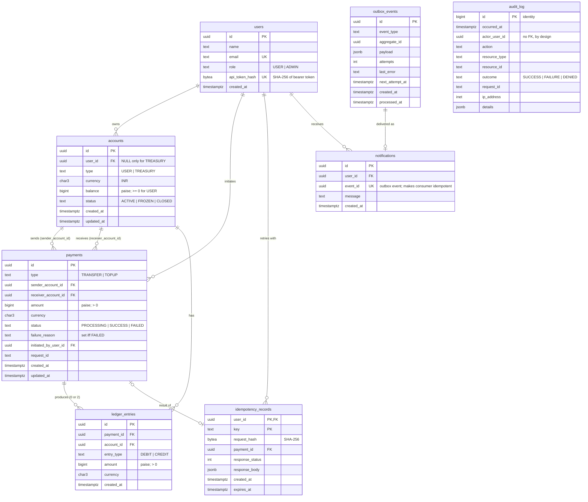

# FinCore — Database Schema Design (Phase 1)

> **Status:** Proposed — to be agreed before migrations are written.\
> **Implements:** Blueprint v0.2, §5 and §8.\
> **Target:** PostgreSQL 16.

## 1. Entity-relationship diagram



## 2. Table-by-table design

Conventions:

- Primary keys are `uuid DEFAULT gen_random_uuid()` (built into PostgreSQL 13+), except `audit_log`.
- All timestamps are `timestamptz`, stored in UTC, default `now()`.
- Enumerations are `text` + `CHECK (... IN (...))` rather than PostgreSQL `ENUM` types — easier to evolve with migrations.
- Money is `bigint` paise. `currency` is `char(3)`, `CHECK (currency = 'INR')` in V1.
- `updated_at` is set explicitly by the application in the same statement that changes the row.

### 2.1 `users`

| Column | Type | Constraints |
|---|---|---|
| `id` | uuid | PK |
| `name` | text | NOT NULL, length 1–200 |
| `email` | text | NOT NULL; unique on `lower(email)` |
| `role` | text | NOT NULL, `IN ('USER','ADMIN')`, default `USER` |
| `api_token_hash` | bytea | NOT NULL, UNIQUE, length 32 |
| `created_at` | timestamptz | NOT NULL |

**Why `api_token_hash`:** minimal auth for V1 (Blueprint §16 #9). `fincorectl` generates a random token, shows it once, and stores only its SHA-256. On each request the API hashes the bearer token and looks it up by the unique index. A database leak does not reveal usable tokens. Phase 7 replaces this with JWT.

### 2.2 `accounts`

| Column | Type | Constraints |
|---|---|---|
| `id` | uuid | PK |
| `user_id` | uuid | FK → `users(id)`, NULL only for treasury |
| `type` | text | `IN ('USER','TREASURY')` |
| `currency` | char(3) | `= 'INR'` |
| `balance` | bigint | NOT NULL, default 0 |
| `status` | text | `IN ('ACTIVE','FROZEN','CLOSED')`, default `ACTIVE` |
| `created_at`, `updated_at` | timestamptz | NOT NULL |

Table-level checks:

```sql
CHECK (
  (type = 'USER'     AND user_id IS NOT NULL AND balance >= 0) OR
  (type = 'TREASURY' AND user_id IS NULL)
)
```

Indexes:

- `UNIQUE (currency) WHERE type = 'TREASURY'` — exactly one treasury per currency.
- `(user_id)` — list a user's accounts.

The `balance >= 0` check is a **second line of defence**: the service checks funds while holding the row lock, and if a bug ever slipped through, the database would refuse the commit.

### 2.3 `payments`

| Column | Type | Constraints |
|---|---|---|
| `id` | uuid | PK |
| `type` | text | `IN ('TRANSFER','TOPUP')` |
| `sender_account_id` | uuid | NOT NULL, FK → `accounts(id)` |
| `receiver_account_id` | uuid | NOT NULL, FK → `accounts(id)` |
| `amount` | bigint | NOT NULL, `> 0` |
| `currency` | char(3) | `= 'INR'` |
| `status` | text | `IN ('PROCESSING','SUCCESS','FAILED')` |
| `failure_reason` | text | NULL unless `FAILED` |
| `initiated_by_user_id` | uuid | NOT NULL, FK → `users(id)` |
| `request_id` | text | NOT NULL |
| `created_at`, `updated_at` | timestamptz | NOT NULL |

Table-level checks:

- `sender_account_id <> receiver_account_id`
- `(status = 'FAILED') = (failure_reason IS NOT NULL)` — a failure always has a reason, a success never has one.

Indexes (for history, FR-07):

- `(sender_account_id, created_at DESC, id DESC)`
- `(receiver_account_id, created_at DESC, id DESC)`

**History query** — each branch uses its own index, then merges:

```sql
(SELECT * FROM payments
  WHERE sender_account_id = $1 AND (created_at, id) < ($2, $3)
  ORDER BY created_at DESC, id DESC LIMIT $4)
UNION ALL
(SELECT * FROM payments
  WHERE receiver_account_id = $1 AND (created_at, id) < ($2, $3)
  ORDER BY created_at DESC, id DESC LIMIT $4)
ORDER BY created_at DESC, id DESC
LIMIT $4;
```

This replaces the v0.2 blueprint idea of serving history from `ledger_entries`: failed payments have no ledger entries, so the ledger-based query would need a second source anyway. Two payment indexes are simpler and cover both cases. (Blueprint §8.2 updated accordingly.)

### 2.4 `ledger_entries`

| Column | Type | Constraints |
|---|---|---|
| `id` | uuid | PK |
| `payment_id` | uuid | NOT NULL, FK → `payments(id)` |
| `account_id` | uuid | NOT NULL, FK → `accounts(id)` |
| `entry_type` | text | `IN ('DEBIT','CREDIT')` |
| `amount` | bigint | NOT NULL, `> 0` |
| `currency` | char(3) | `= 'INR'` |
| `created_at` | timestamptz | NOT NULL |

Constraints and indexes:

- `UNIQUE (payment_id, entry_type)` — at most one DEBIT and one CREDIT per payment. Combined with the transaction always inserting both, this gets us most of the way to "exactly two balanced entries" at the database level. The remaining parts (both present, amounts equal) are checked by reconciliation.
- `(account_id, created_at, id)` — account statements and per-account reconciliation.
- **Immutable:** trigger rejects `UPDATE`, `DELETE`, and `TRUNCATE`.

### 2.5 `idempotency_records`

| Column | Type | Constraints |
|---|---|---|
| `user_id` | uuid | PK part 1, FK → `users(id)` |
| `key` | text | PK part 2, length 1–255 |
| `request_hash` | bytea | NOT NULL, length 32 |
| `payment_id` | uuid | NULL, FK → `payments(id)` |
| `response_status` | int | NULL |
| `response_body` | jsonb | NULL |
| `created_at` | timestamptz | NOT NULL |
| `expires_at` | timestamptz | NOT NULL, default `now() + interval '24 hours'` |

Index: `(expires_at)` for the cleanup job.

The composite primary key `(user_id, key)` **is** the uniqueness constraint that makes the in-transaction claim work (Blueprint §6.3). The response columns are NULL only inside the claiming transaction; they are filled before commit, so other sessions never see a committed record without a response.

The request hash covers the **operation** (`payment.create` / `topup.create`) plus the canonical body, so the same key reused across endpoints is a `409`, not a replay.

### 2.6 `audit_log`

| Column | Type | Constraints |
|---|---|---|
| `id` | bigint | PK, `GENERATED ALWAYS AS IDENTITY` |
| `occurred_at` | timestamptz | NOT NULL |
| `actor_user_id` | uuid | NULL (anonymous / system) |
| `action` | text | NOT NULL |
| `resource_type` | text | NULL |
| `resource_id` | text | NULL |
| `outcome` | text | `IN ('SUCCESS','FAILURE','DENIED')` |
| `request_id` | text | NULL |
| `ip_address` | inet | NULL |
| `details` | jsonb | NOT NULL, default `'{}'` |

Indexes: `(actor_user_id, occurred_at)`, `(resource_type, resource_id)`, `(request_id)`.

Design choices:

- **No foreign keys.** The audit log must accept a record even when the referenced thing is invalid (e.g. a denied request for an account ID that does not exist), and must never block or be blocked by changes elsewhere.
- **`bigint` identity**, not UUID: gives a natural insertion order, which is what investigators read.
- **Immutable:** same trigger as the ledger.

### 2.7 `outbox_events`

| Column | Type | Constraints |
|---|---|---|
| `id` | uuid | PK |
| `event_type` | text | NOT NULL |
| `aggregate_id` | uuid | NOT NULL (e.g. payment ID) |
| `payload` | jsonb | NOT NULL |
| `attempts` | int | NOT NULL, default 0 |
| `last_error` | text | NULL |
| `next_attempt_at` | timestamptz | NOT NULL, default `now()` |
| `created_at` | timestamptz | NOT NULL |
| `processed_at` | timestamptz | NULL |

Index: `(next_attempt_at) WHERE processed_at IS NULL` — the worker's polling query only ever scans pending events.

### 2.8 `notifications` (consumed in Phase 5)

| Column | Type | Constraints |
|---|---|---|
| `id` | uuid | PK |
| `user_id` | uuid | NOT NULL, FK → `users(id)` |
| `event_id` | uuid | NOT NULL, UNIQUE |
| `message` | text | NOT NULL |
| `created_at` | timestamptz | NOT NULL |

`UNIQUE (event_id)` makes the outbox consumer idempotent: a re-delivered event hits `ON CONFLICT DO NOTHING`.

## 3. Immutability enforcement

```sql
CREATE FUNCTION fincore_reject_modification() RETURNS trigger AS $$
BEGIN
  RAISE EXCEPTION '% on % is not allowed: table is append-only',
    TG_OP, TG_TABLE_NAME
    USING ERRCODE = 'insufficient_privilege';
END;
$$ LANGUAGE plpgsql;

-- For each of ledger_entries, audit_log:
CREATE TRIGGER <table>_no_update_delete
  BEFORE UPDATE OR DELETE ON <table>
  FOR EACH ROW EXECUTE FUNCTION fincore_reject_modification();
CREATE TRIGGER <table>_no_truncate
  BEFORE TRUNCATE ON <table>
  FOR EACH STATEMENT EXECUTE FUNCTION fincore_reject_modification();
```

## 4. Database roles

| Role | Used by | Privileges |
|---|---|---|
| `fincore` (owner) | Migrations (`goose`) | Owns all objects |
| `fincore_app` | API and worker | `SELECT, INSERT, UPDATE` on mutable tables; `SELECT, INSERT` only on `ledger_entries` and `audit_log`; `DELETE` only on `idempotency_records` (cleanup) |

Two layers protect the ledger and audit log: the app role is never granted `UPDATE`/`DELETE` on them, and the trigger stops even the owner unless it is explicitly disabled in a migration.

## 5. Invariants and where they are enforced

| Invariant | Database | Application | Reconciliation |
|---|---|---|---|
| No float money | `bigint` columns | `int64` | — |
| Positive amounts | `CHECK > 0` | validation | — |
| User balance never negative | `CHECK` | funds check under lock | ✓ |
| One treasury per currency | partial unique index | — | — |
| Sender ≠ receiver | `CHECK` | validation | — |
| Failed ⇔ has reason | `CHECK` | — | — |
| ≤ 1 debit and ≤ 1 credit per payment | `UNIQUE (payment_id, entry_type)` | — | — |
| SUCCESS payment has exactly 2 equal entries | — | single transaction | ✓ |
| Balance = sum of ledger | — | single transaction | ✓ |
| Global ledger sum = 0 | — | — | ✓ |
| Ledger and audit immutable | trigger + grants | — | — |
| Idempotency key unique per user | composite PK | in-transaction claim | — |

## 6. Migration plan

Each file is a `goose` SQL migration with `Up` and `Down` sections.

| # | File | Contents |
|---|---|---|
| 1 | `00001_create_users.sql` | `users` |
| 2 | `00002_create_accounts.sql` | `accounts`, treasury partial unique index |
| 3 | `00003_create_payments.sql` | `payments`, history indexes |
| 4 | `00004_create_ledger_entries.sql` | `ledger_entries`, immutability function + triggers |
| 5 | `00005_create_idempotency_records.sql` | `idempotency_records` |
| 6 | `00006_create_audit_log.sql` | `audit_log`, triggers |
| 7 | `00007_create_outbox_and_notifications.sql` | `outbox_events`, `notifications` |
| 8 | `00008_create_app_role_grants.sql` | `fincore_app` role and grants |
| 9 | `00009_seed_treasury.sql` | INR treasury account |

Phase 1 is done when: migrations apply cleanly up and down on an empty database, CI runs them against a PostgreSQL service container, and a test proves `UPDATE`/`DELETE` on `ledger_entries` and `audit_log` fail.

## 7. Decisions

1. **App role (§4):** created in Phase 1 (migration 8), protecting the audit log and ledger from day one.
2. **`updated_at` maintenance:** set by the application; no trigger.
